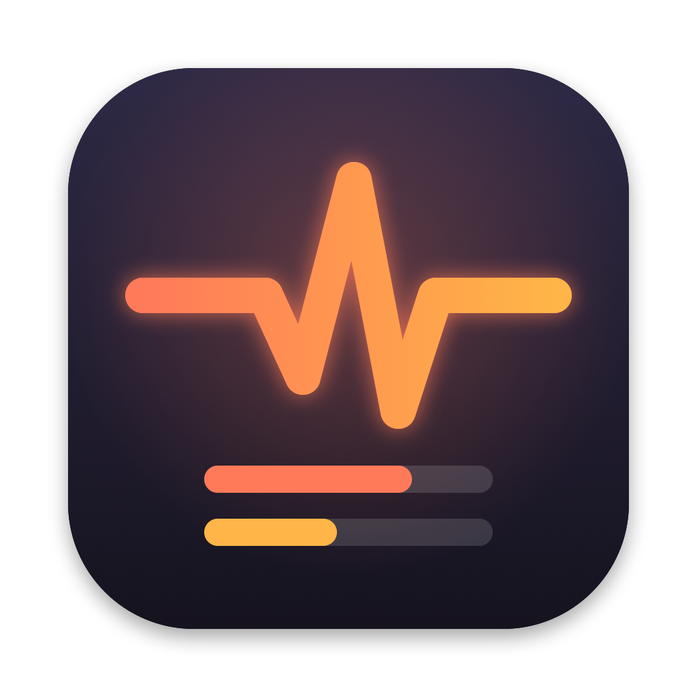

<p align="center">
  
</p>

# Claude Pulse

A macOS menu bar app for Claude Code. It shows your plan limits and every running session at a glance, tells you when a session needs you or has finished, and lets you answer permission prompts without switching windows.

**Website:** [manoj6418.github.io/claude-pulse](https://manoj6418.github.io/claude-pulse/) · **Download:** [latest release](https://github.com/manoj6418/claude-pulse/releases/latest)

Unofficial; not affiliated with Anthropic.

## What it shows

**Plan usage**
- 5-hour and 7-day limits with local reset time and countdown.
- A pace marker (how much of the window has passed), a small usage chart, and a projection ("~63% by reset", or "you hit 100% at 4:10 PM").
- **Today**: API-equivalent cost and tokens, split by model and project, with CSV export.

**Every running session**
- Name, context used (tokens / window and %), cost, lines changed, and its share of the last hour's spend.
- What it is doing now: "Running go test ./... · 42s", "Editing edd.go", "Working · 3m", "Agents working", or "Possibly stuck" after 10 quiet minutes.
- Git branch and state ("WE-29048 · 3 uncommitted · 2 unpushed", or "clean").
- Prompt cache: "cache 97% · warm 41m", or "cold" once it expired (the next message then costs more).
- Background agents running, "Auto-compact soon" near the end of the context window, and how many times it compacted.
- A red line when the last command failed ("Failed: go test · Exit code 1"), and the last 10 steps (click the arrow on a row).
- Model and effort appear once in the Sessions header; a card only shows its own when it differs.

**When a session needs you**
- A permission prompt puts the session at the top with **Allow / Always allow / Deny**, and the notification has the same buttons. The terminal prompt stays open too; whichever you answer first wins. Plan approvals and Claude's questions stay in the terminal.
- Only permission prompts count as "need you" in the panel and the menu bar. A session that finished and is waiting for your next message shows a quiet "Your turn".

**Getting around**
- Click a session (or its notification) to bring its terminal forward. Terminal and iTerm select the exact tab; other terminals just come forward.
- Right-click a session to pin it, rename it, give it a colour, copy the resume command, open its folder or reveal its transcript.
- The **+** button starts `claude` in a recent project folder, in Terminal or iTerm.
- ⌃⌥C opens the panel from anywhere. ⌘↩ allows and ⌘⌫ denies the top permission prompt.
- Optional: group sessions by project, hide sessions idle for 30+ minutes.
- Menu bar: two small bars (5-hour on top, 7-day below), or a percentage, or just the icon.

## Notifications

| Alert | Default |
|---|---|
| A session finished (only if it worked 30s+; shows how long and the first line of the reply) | On |
| A session needs permission (with Allow / Deny buttons) | On |
| Plan usage reaches 90% | On |
| A limit reset (after you'd used at least half) | On |
| A command still running after 15 minutes | On |
| A session closed with uncommitted or unpushed changes it made | On |
| Weekly summary, Friday 6 PM | On |
| Waiting for your input · context almost full · daily budget · daily summary | Off |

Banners for a session are skipped while its terminal is the app in front. A **Recent** list in the panel keeps the last few events. Every notification sent is listed in `~/Library/Application Support/ClaudePulse/notifications.log`.

**Phone alerts** (off by default): "finished" and "needs permission" can also go to your phone through [ntfy](https://ntfy.sh). Install the ntfy app, subscribe to the private topic shown in Settings → Phone alerts, and press **Send test to phone**. By default they carry only the session name and what happened, never the command or reply text.

## Install

Download the DMG from [Releases](https://github.com/manoj6418/claude-pulse/releases), open it and drag **Claude Pulse** onto **Applications**.

The app is not signed with an Apple Developer ID, so macOS blocks the first launch. Open **System Settings → Privacy & Security → Open Anyway**, or run once:

```sh
xattr -dr com.apple.quarantine /Applications/ClaudePulse.app
```

Then click the menu bar icon → **Connect**, and restart running Claude Code sessions.

### Build from source

Needs macOS 14+ and the Xcode Command Line Tools (full Xcode is not required).

```sh
make install   # builds, copies to ~/Applications, launches
make dmg       # builds build/ClaudePulse-<version>.dmg for sharing
make icon      # redraws the icon and social preview from assets/make-logo.swift
```

## How it gets its data

| Data | Source |
|---|---|
| Running sessions, name, folder, busy/idle | `~/.claude/sessions/<pid>.json` (written by Claude Code) |
| Model, effort, context, branch, prompt cache | The tail of each session's transcript in `~/.claude/projects/` |
| 5h / 7d limits, exact context %, cost, tokens | The status line JSON Claude Code passes to `ClaudePulse --statusline` |
| Current step, failures, agents, permission prompts, finished | Hook events passed to `ClaudePulse --hook` |
| Uncommitted / unpushed changes | `git status` in each session's folder, at most every 30 s, without taking git's lock |

**Connect** edits `~/.claude/settings.json`:
- It sets `statusLine` to `ClaudePulse --statusline`. If you already had a status line, it keeps running and its output is still shown (Pulse only listens in). Otherwise Pulse prints a compact line: `Opus 5.5 high · ctx 14% · 5h 23% ↻2h13m · 7d 41%`.
- It adds a `ClaudePulse --hook` command to UserPromptSubmit, PreToolUse, PostToolUse, PostToolUseFailure, Notification, Stop, PreCompact, SessionEnd, SubagentStart and SubagentStop (each run takes about 30 ms), and to PermissionRequest, where it waits up to 10 minutes for an answer from the panel. Allow needs an unlocked Mac.
- It saves a backup first (`settings.json.claudepulse-backup-<time>`). **Disconnect** removes only Pulse's entries and restores your old status line. When a new version needs more hooks, the panel shows **Connection incomplete** with a **Repair** button.

The limits appear after the next reply in any connected session, and only on Pro/Max plans; Claude Code does not report them otherwise. "Today" counts spend reported while Claude Pulse is running.

## Privacy

- No Keychain access and no undocumented APIs.
- Network calls: the Claude status page (status.claude.com) every 5 minutes and GitHub's latest-release check every 12 hours, both can be turned off in Settings → Online; and phone alerts, only if you turn them on.
- Everything else stays in `~/Library/Application Support/ClaudePulse/`, which only your user can read.

## Command line

```sh
ClaudePulse --status | --connect | --disconnect
ClaudePulse --toggle-panel                          # open or close the panel
ClaudePulse --capture-panel out.png [--settings]    # screenshot of the running panel
ClaudePulse --capture-panel out.png --menubar       # screenshot of the menu bar item
ClaudePulse --snapshot out.png [--dark] [--settings] # render the panel without the running app
ClaudePulse --test-notification | --phone-test | --notification-settings
```

The binary is at `/Applications/ClaudePulse.app/Contents/MacOS/ClaudePulse` (or `~/Applications/…` when built with `make install`).

## Ideas for later

- Per-model weekly limits, once Claude Code exposes them in the status line.
- Exact-tab jump for Ghostty, Kitty and VS Code.
- Settings in their own window; VoiceOver labels for the icon buttons.
- A WidgetKit widget.
- Apple signing and notarization, so the first launch needs no "Open Anyway", and automatic updates.
